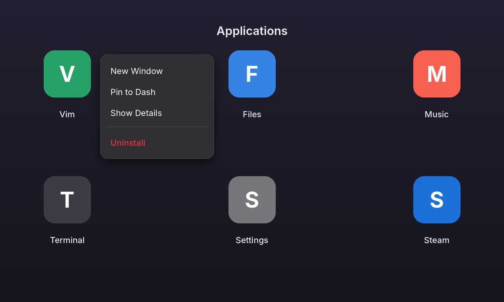

# gnome_uninstall_app

GNOME Shell üçün extension: proqramın sağ klik menyusuna qırmızı **Uninstall** əlavə edir.
Yalnız qısayolu yox, **bütün proqramı** silir və başqa heç nəyə toxunmur.

[English](README.md)

  

## İmkanlar
- App grid və ya dash-da proqrama sağ klik → **Uninstall**
- Silməzdən əvvəl təsdiq pəncərəsi
- Müxtəlif distro və paket formatlarında işləyir
- Yalnız seçilmiş proqramı silir: əlavə asılılıqları və şəxsi məlumatları yox
- Silə bilmədiyi proqramda səbəbi izah edir

## Dəstəklənən mənbələr

| Mənbə | Distrolar | Silmə əmri |
|---|---|---|
| pacman / AUR | Arch, Manjaro, EndeavourOS | `pacman -R` |
| dpkg | Debian, Ubuntu, Mint*, Pop!_OS | `dpkg --remove` |
| rpm | Fedora, openSUSE | `rpm -e` |
| Flatpak | hamısı | `flatpak uninstall` |
| Snap | Ubuntu və s. | `snap remove` |
| Steam oyunları | hamısı | Steam-in öz silmə pəncərəsi |
| AppImage | hamısı | Trash-ə atılır (geri qaytarıla bilər) |

\* Linux Mint-in standart masaüstü Cinnamon-dur. Extension GNOME sessiyası tələb edir.

> Arch Linux-da (GNOME) yazılıb və sınanıb. Digər distrolar üçün dəstək var, amma az sınanıb.

## Təhlükəsizlik
- `pacman -R`, `dpkg --remove` və `rpm -e` başqa paketlərin asılı olduğu paketi silməkdən **imtina edir** və əlavə asılılıqları silmir.
- `gnome-shell`, `gdm`, `mutter`, paket menecerləri, `systemd` kimi kritik paketlərdə düymə verilmir.
- Tanımadığı proqramda boz **Uninstall (unavailable)** çıxır, üzərinə basanda səbəbi göstərilir.
- Home qovluğunuza, ayarlara və keşə toxunulmur.
- Silmə qalıcıdır (AppImage istisna). Öz məsuliyyətinizlə istifadə edin.

## Quraşdırma (terminalsız)
Ətraflı: [docs/INSTALL.md](docs/INSTALL.md)

1. **Releases** bölməsindən `gnome_uninstall_app@local.zip` yüklə və aç.
2. `gnome_uninstall_app@local` qovluğunu `~/.local/share/gnome-shell/extensions/` içinə köçür (Files-da `Ctrl+H` ilə `.local` görünür).
3. Logout/login et, **Extensions** proqramında extension-ı aktiv et.

## Silmək və problemlər
[docs/UNINSTALL.md](docs/UNINSTALL.md) · [docs/TROUBLESHOOTING.md](docs/TROUBLESHOOTING.md)

## Lisenziya
[MIT](LICENSE)
