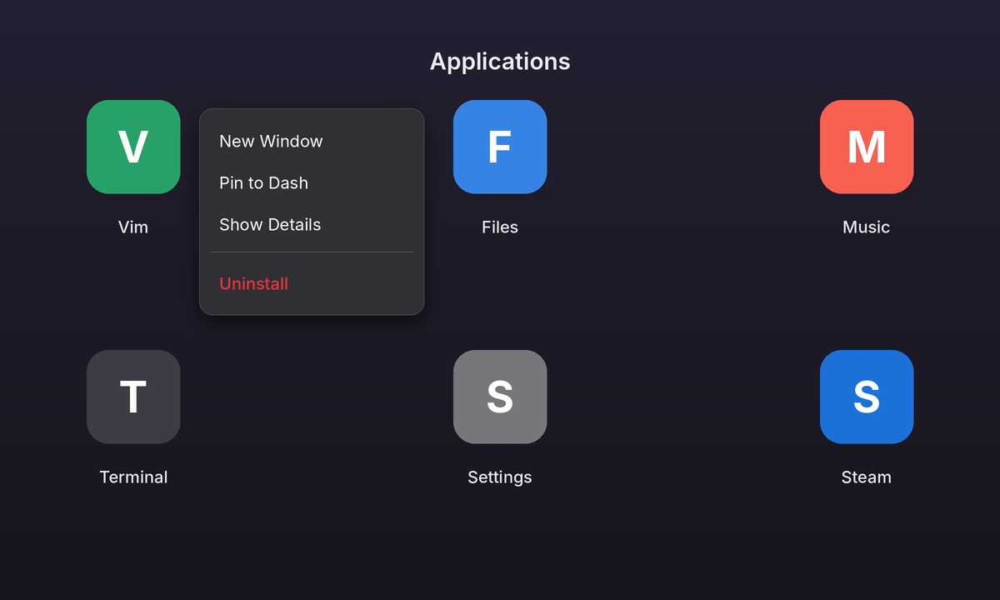
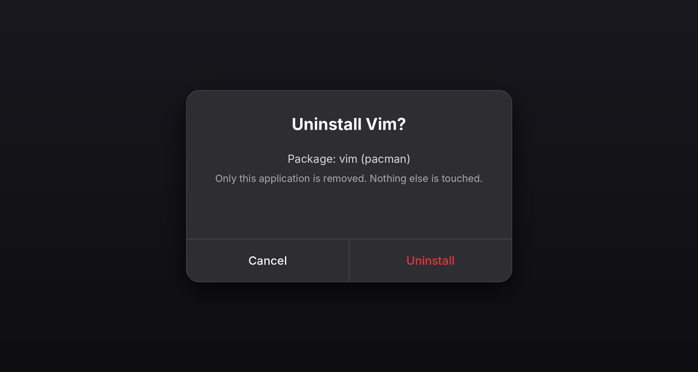

# gnome_uninstall_app

A GNOME Shell extension that adds an **Uninstall** item (in red) to the app context menu.
It removes the **whole application**, not just the shortcut, and touches nothing else.

🇦🇿 [Azərbaycan dilində](README.az.md)

  

## Features
- Right-click any app in the app grid or dash → **Uninstall**
- Confirmation dialog before anything is removed
- Works across distros and package formats (see below)
- Removes only the selected app: no extra dependencies, no personal data
- Safe by design: package tools that refuse to break dependencies, protected system packages
- Clear explanation when an app cannot be removed

  

## Supported sources

| Source | Distros | Command used | Notes |
|---|---|---|---|
| pacman / AUR | Arch, Manjaro, EndeavourOS | `pkexec pacman -R` | Only that package |
| dpkg | Debian, Ubuntu, Linux Mint*, Pop!_OS | `pkexec dpkg --remove` | Config files kept (no purge) |
| rpm | Fedora, RHEL family, openSUSE | `pkexec rpm -e` | Only that package |
| Flatpak | all | `flatpak uninstall -y` | App data in `~/.var/app` is kept |
| Snap | Ubuntu and others | `pkexec snap remove` | snapd may keep a data snapshot |
| Steam games | all | `steam steam://uninstall/<id>` | Steam shows its own confirmation |
| AppImage | all | moved to Trash | Only AppImages inside your home folder; restorable |

\* Linux Mint ships Cinnamon by default. The extension needs a GNOME session.

> Developed and tested on Arch Linux (GNOME). The other backends are implemented but less tested.
> Test reports from Debian, Ubuntu, Fedora and openSUSE are very welcome.

## How it works
1. When you open an app's context menu, the extension reads the app's `.desktop` file.
2. It finds the owner: Steam shortcut, Flatpak, Snap, AppImage, or the distro package (`pacman -Qqo`, `dpkg -S`, `rpm -qf`).
3. **Uninstall** asks for confirmation, then runs the removal command (system packages ask for your password via polkit).

### Safety
- Low-level tools are used on purpose: they **refuse** to remove a package that other packages depend on and never remove extra dependencies.
- Critical packages (`gnome-shell`, `gdm`, `mutter`, package managers, `systemd`, ...) are never offered for removal.
- Apps from unknown sources show a grey **Uninstall (unavailable)**; clicking it explains why.
- Your home directory, settings and caches are never deleted.
- Removal is permanent (except AppImages, which go to the Trash). Use at your own risk.

## Installation
Full guide: **[docs/INSTALL.md](docs/INSTALL.md)** (no terminal needed).

Short version:
1. Download `gnome_uninstall_app@local.zip` from **Releases** and extract it.
2. Move the `gnome_uninstall_app@local` folder to `~/.local/share/gnome-shell/extensions/` (press `Ctrl+H` in Files to see `.local`).
3. Log out and back in, then enable the extension in the **Extensions** app.

## Removing the extension
See **[docs/UNINSTALL.md](docs/UNINSTALL.md)**.

## Troubleshooting
See **[docs/TROUBLESHOOTING.md](docs/TROUBLESHOOTING.md)**.

## Contributing
See **[CONTRIBUTING.md](CONTRIBUTING.md)**. Changes are listed in **[CHANGELOG.md](CHANGELOG.md)**.

## License
[MIT](LICENSE)
